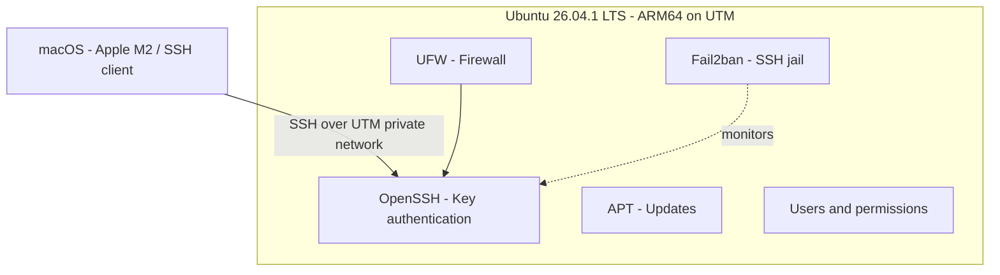

# Linux Server Hardening

**Hands-on cybersecurity lab | Ubuntu Server · OpenSSH · UFW · Fail2ban · Linux permissions**

A practical project to configure and assess common security controls on an Ubuntu virtual machine. I built the lab on an Apple M2 Mac using UTM, connected to the VM through SSH, configured access controls, and documented the checks and troubleshooting.

> **Project status:** The core hardening steps are reported working and several results are recorded. A complete evidence-backed final audit (screenshots, user/sudo review, listening ports, and update/reboot confirmation) is still being assembled. This is a learning lab, not a certified secure production system.

## 1. Lab architecture



**Environment:** macOS on Apple M2; UTM virtual machine; Ubuntu 26.04.1 LTS (ARM64/aarch64). A lab IP of `192.168.64.3` was observed but may change.

## 2. Security goals and controls

| Risk | Mitigation | Evidence status |
| --- | --- | --- |
| SSH password guessing | Ed25519 key-based SSH; password authentication restriction | User-confirmed; output to archive |
| Direct root remote access | Root SSH login restriction | User-confirmed; output to archive |
| Unnecessary incoming traffic | UFW default incoming policy and SSH allow rule | User-confirmed; output to archive |
| Repeated authentication failures | Fail2ban SSH jail | Configuration test and 3600-second ban time observed |
| Overly broad file access | Restricted permissions for a test file and private SSH key | Permission results observed |
| Unpatched packages | APT update and upgrade workflow | Latest check user-confirmed; upgrade details pending |

## 3. Implementation highlights

### SSH remote administration

- Connected from macOS to the Ubuntu VM through OpenSSH.
- Generated an Ed25519 key pair on macOS.
- Configured key-based authentication and checked SSH restrictions (user-confirmed).
- Kept the SSH client private key on macOS.

### UFW firewall

- Practiced default-deny incoming rules while preserving SSH access.
- Verified the firewall workflow from the UTM lab (user-confirmed).

### Fail2ban

Configured an `sshd` jail with the intended lab values:

```ini
[sshd]
enabled = true
port = ssh
backend = systemd
maxretry = 5
findtime = 10m
bantime = 1h
```

**Observed evidence:** `sudo fail2ban-client -t` returned a successful configuration test, and `get sshd bantime` changed from `600` to `3600` after restarting Fail2ban.

### Linux permissions and updates

- Practiced `ls -l`, `chmod`, and SSH key file permissions.
- Used APT to inspect available package updates.
- Investigated an APT repository timestamp error without disabling date checks.

## 4. Project progress

- [x] Install Ubuntu in UTM
- [x] Record initial OS, user and network observations
- [x] Practice Linux file permissions
- [x] Generate SSH keys on macOS
- [x] Configure and test SSH key login and restrictions (user-confirmed)
- [x] Configure and check UFW (user-confirmed)
- [x] Configure Fail2ban; verify config syntax and 1-hour ban time
- [x] Perform package update checks (user-confirmed)
- [x] Create comparison and final audit documentation
- [ ] Add sanitized screenshots / terminal transcripts for the final controls
- [ ] Record full user/`sudo` audit and listening sockets
- [ ] Record whether upgrades and reboot were necessary and completed

## 5. Documentation

| File | Focus |
| --- | --- |
| [01 — Initial assessment](documentation/01-initial-assessment.md) | Ubuntu, user, network and SSH baseline |
| [02 — Linux permissions](documentation/02-linux-permissions.md) | Permissions exercise and SSH key file modes |
| [03 — SSH hardening](documentation/03-ssh-hardening.md) | Key authentication and SSH restrictions |
| [04 — UFW firewall](documentation/04-ufw-firewall.md) | Firewall policy and SSH access |
| [05 — Fail2ban](documentation/05-fail2ban.md) | SSH jail setup, verification and troubleshooting |
| [06 — Security updates](documentation/06-security-updates-and-audit.md) | APT and update checks |
| [07 — Before and after](documentation/07-before-after-comparison.md) | Security-control comparison |
| [08 — Final audit](documentation/08-final-security-audit.md) | Evidence register and remaining checks |
| [Evidence guide](evidence/README.md) | Safe screenshot collection |

## 6. Troubleshooting and lessons learned

**Wrong paths / command typos.** I corrected `/etc/jail2ban` to `/etc/fail2ban` and `sysytemctl` to `systemctl`. These small mistakes highlighted the importance of precise Linux commands.

**Fail2ban runtime settings.** Initially, `get sshd bantime` returned `600`. After testing and restarting the configured jail, it returned `3600`. This showed why verifying *effective* settings is more useful than only editing a file.

**Package repository dates.** `apt update` initially rejected repository metadata as not yet valid. I investigated system time rather than bypassing APT security validation.

**SSH client versus server.** I learned the difference between keys generated on the Ubuntu VM and keys generated on the Mac, which initiates the SSH connection.

## 7. Security and scope notes

- This lab uses an isolated virtual machine; it does not claim enterprise-grade assurance.
- The operator reported final checks successful, but some raw outputs are not archived yet.
- No private SSH keys, passphrases, tokens or passwords belong in the repository.
- Examples and intended configurations must not be mistaken for independent evidence of running state.

## 8. Next improvements

Complete the [final audit](documentation/08-final-security-audit.md), add sanitized real evidence to `evidence/`, document an account/sudo review and listening services, and record the outcome of package upgrades and any reboot.
